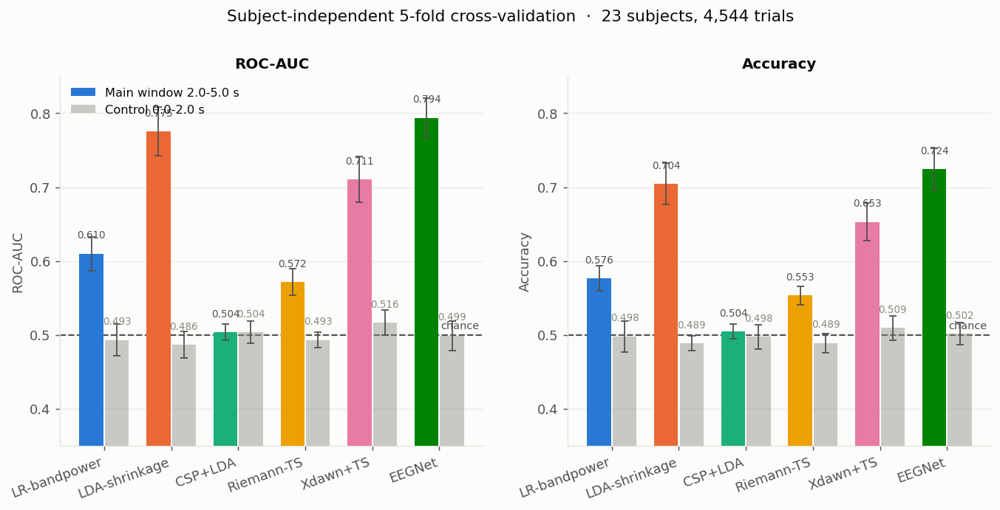
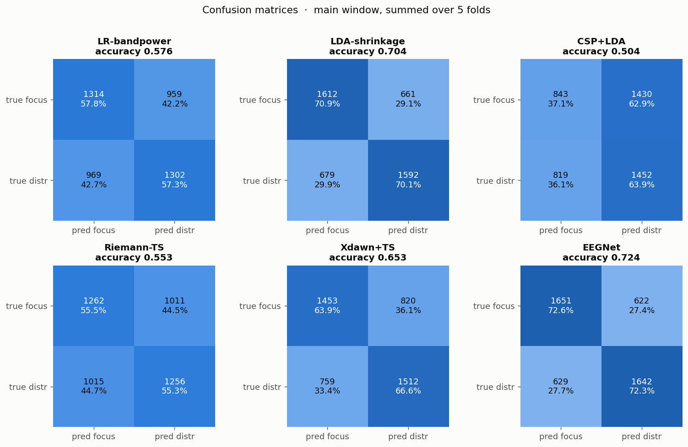
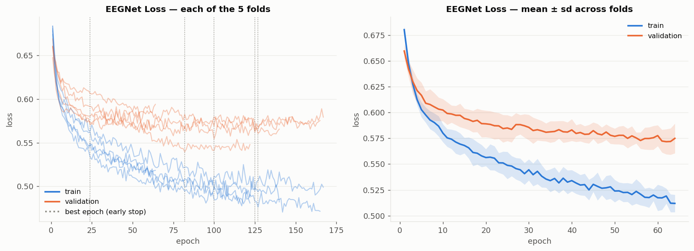
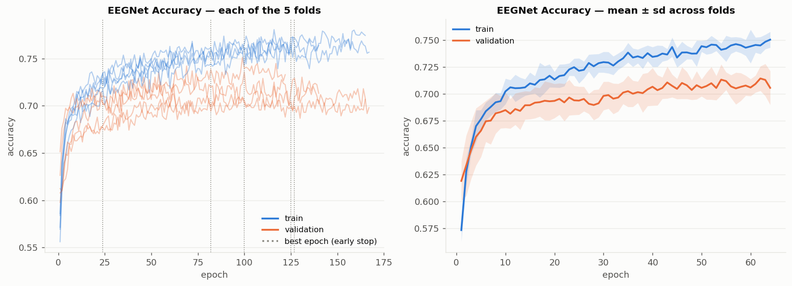
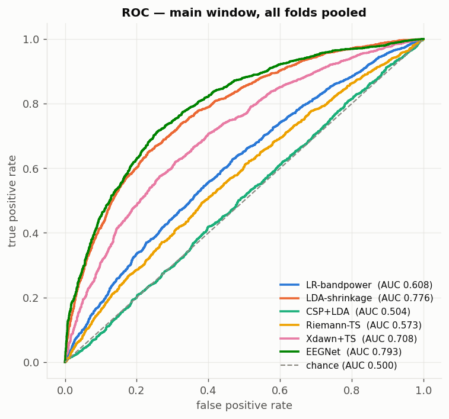
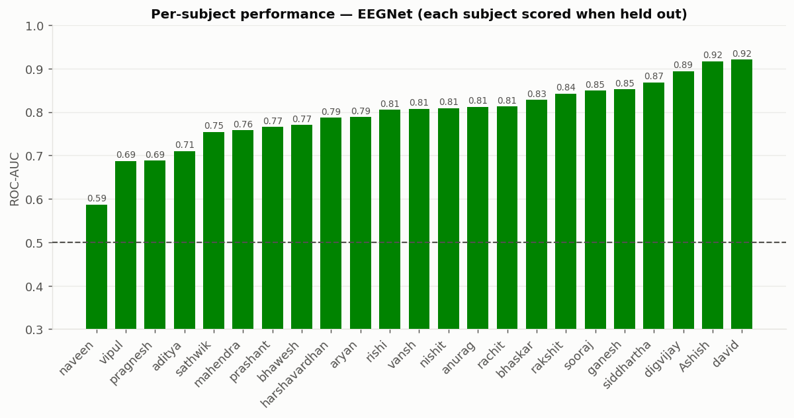
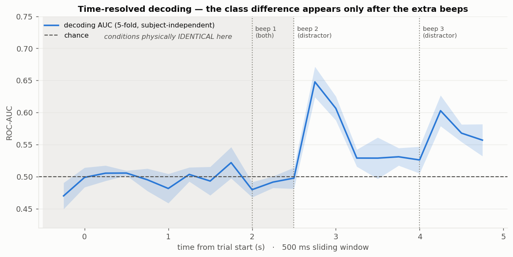

# EEG Focus vs. Distraction

**Decoding the brain's response to phone-style notification interruptions from 15-channel EEG.**

[](https://www.python.org/)
[](https://mne.tools/)
[](https://pytorch.org/)
[](https://scikit-learn.org/)
[]()

---

## Overview

24 participants solved timed word puzzles while phone-style notifications interrupted
them. Every trial carried a notification image plus **1 beep** (focus) or **3 beeps**
(distractor). This repository contains the complete, verified pipeline that takes raw
BrainVision recordings through to a subject-independent deep-learning classifier.

**Headline result — EEGNet, subject-independent 5-fold: accuracy 0.724 ± 0.028, ROC-AUC 0.794 ± 0.026.**

The model is evaluated on people it has never seen, and every leakage guardrail passes.
But the honest interpretation is narrower than "we detect distraction" — see
[The Central Caveat](#-the-central-caveat-what-the-model-actually-detects), which is the
most important section in this README.

| | |
|---|---|
| **Participants** | 23 analysed (24 recorded, 1 excluded) |
| **Trials** | 4,600 recorded → **4,544** after cleaning (98.8% retained) |
| **Class balance** | 2,273 focus / 2,271 distractor |
| **Channels** | 15 EEG (from 19 raw), 500 Hz → 250 Hz |
| **Best model** | EEGNet-8,2 (~2,000 parameters) |
| **Evaluation** | Subject-independent 5-fold — test subjects never appear in training |
| **Model failures** | 0 |

---

## Results

### Main window (2.0–5.0 s post trial-start)

| Model | Accuracy | Balanced acc. | **ROC-AUC** | F1 (macro) | Cohen's κ |
|---|---|---|---|---|---|
| **EEGNet** | **0.724 ± 0.028** | 0.724 ± 0.028 | **0.794 ± 0.026** | 0.724 | 0.448 |
| LDA-shrinkage | 0.704 ± 0.028 | 0.704 ± 0.028 | 0.775 ± 0.033 | 0.704 | 0.408 |
| Xdawn+TS | 0.653 ± 0.026 | 0.653 ± 0.025 | 0.711 ± 0.031 | 0.652 | 0.306 |
| LR-bandpower | 0.576 ± 0.017 | 0.576 ± 0.017 | 0.610 ± 0.023 | 0.576 | 0.153 |
| Riemann-TS | 0.553 ± 0.012 | 0.553 ± 0.012 | 0.572 ± 0.018 | 0.553 | 0.107 |
| CSP+LDA | 0.504 ± 0.010 | 0.505 ± 0.010 | 0.504 ± 0.011 | 0.475 | 0.009 |
| *SHUFFLED control* | *0.486 ± 0.026* | *0.486* | *0.477 ± 0.036* | *0.486* | *−0.028* |

Sensitivity and specificity are balanced for every real model (EEGNet 0.721 / 0.727), and
EEGNet's errors are near-symmetric (622 vs. 629 misclassifications) — no class bias.

**Why CSP fails (0.504).** CSP searches for differences in *oscillatory power*. The signal
here is a *time-locked evoked response*. CSP is the right tool for the wrong physics — its
failure is informative rather than a bug.

> **⚠ Xdawn+TS is numerically unstable — read 0.711 as 0.71 ± 0.02.**
> Adding noise of ±0.001 µV (a thousand times below any real signal) shifts its AUC by up
> to 0.016, while Riemann-TS moves by 0.0001 under the same perturbation. Cause: Xdawn
> performs a generalised eigendecomposition, but our covariance is only **rank ~11 of 15**
> (average referencing removes one degree of freedom, ICA removes ~3 more). Near-degenerate
> eigenvalues make eigenvector directions swing under infinitesimal input changes. Do not
> quote Xdawn to three decimals; the model *ranking* is unaffected.

### Consistency

Per-fold AUC for EEGNet: **0.767 / 0.832 / 0.794 / 0.804 / 0.773** — stable across every split.

**Per subject (each scored while held out): 23 / 23 above chance.**
Best — david 0.921, Ashish 0.917, digvijay 0.894. Worst — naveen 0.587, vipul 0.688,
pragnesh 0.688.

---

## 🛡 The Central Caveat: what the model actually detects

**Not attention. Sound.**

The two classes are not "concentrating" vs. "distracted" — they are **1 beep** vs.
**3 beeps**. The notification *image* is identical in both conditions (verified across all
4,800 original trials). The only physical difference is two extra beeps at 2.5 s and 4.0 s.

### The control-window test

Every model was re-run on **0.0–2.0 s**, where the two conditions are *physically
identical* because no second beep has fired yet. Everything must land at chance:

| Model | Accuracy | ROC-AUC |
|---|---|---|
| Xdawn+TS | 0.509 ± 0.016 | 0.516 ± 0.017 |
| SHUFFLED control | 0.510 ± 0.016 | 0.508 ± 0.026 |
| CSP+LDA | 0.498 ± 0.016 | 0.504 ± 0.015 |
| **EEGNet** | 0.502 ± 0.015 | **0.499 ± 0.020** |
| Riemann-TS | 0.489 ± 0.013 | 0.493 ± 0.011 |
| LR-bandpower | 0.498 ± 0.021 | 0.493 ± 0.021 |
| LDA-shrinkage | 0.489 ± 0.010 | 0.486 ± 0.018 |

**All seven sit between 0.486 and 0.516.** Nothing leaks. EEGNet — the model most capable
of finding a shortcut — scores 0.499, dead on chance. *This is what makes the 0.794
believable:* a pipeline with a subject-identity leak or a label-alignment bug would score
above chance here too.

### Four independent lines of evidence

1. **All 6 models sit at chance on the physically-identical control window** (table above).
2. **EEGNet's early stopping agrees, with no metric involved.** Mean best epoch is **92** on
   the main window but **4** on the control window (folds: 2, 2, 16, 1, 1) — validation loss
   bottomed out at epoch 1–2 and never improved. The network found nothing to learn.
3. **Decoding rises only after each extra beep, then decays.** Time-resolved 500 ms
   sliding window:

   | Time from trial start | AUC | |
   |---|---|---|
   | −0.25 → +2.50 s | 0.47 – 0.52 | flat at chance — conditions physically identical |
   | **+2.75 s** | **0.648** | ← beep 2 fires at 2.5 s |
   | +3.00 s | 0.606 | |
   | +3.25 → +4.00 s | 0.53 | decays toward chance |
   | **+4.25 s** | **0.603** | ← beep 3 fires at 4.0 s |
   | +4.50 s | 0.568 | |

4. **Time-domain models beat frequency-domain ones** — LDA on ERP bins 0.775 and EEGNet
   0.794, versus band-power LR 0.610. That is the signature of a time-locked evoked
   response, not an oscillatory state change.

A grand-average difference wave (distractor − focus) at Cz confirms the same timing and
simultaneously validates trial alignment:

```
-0.5 to 0.0 s   0.09 µV   pre-trial baseline
 0.0 to 2.0 s   0.13 µV   CONTROL — no beep yet
 2.0 to 2.5 s   0.12 µV   CONTROL — after beep 1 only
 2.5 to 3.5 s   0.41 µV   after BEEP 2   ← jumps here
 3.5 to 4.0 s   0.14 µV   gap — falls back
 4.0 to 5.0 s   0.37 µV   after BEEP 3   ← jumps again
```

Two alternative explanations were ruled out: it is **not the button press** (which key was
pressed decodes at only 0.529, and on trials with no answer at all condition still decodes
at 0.604), and **not random noise** (shuffled labels give 0.486).

### Honest framing

> This is a working detector for ***"did an interruption event occur, and did the brain
> respond to it?"*** — at AUC 0.794 across unseen people, a genuinely solid result.
> It is **not** a detector of whether someone is concentrating.

**For any future recording, the single change that matters: give both conditions the same
number of beeps.** Everything above traces back to that one design choice.

---

## Experiment design

Each participant saw a scrambled word and a claim such as *"(count C + N) = 2"*, pressing
**RIGHT** for true or **LEFT** for false within 3 seconds. A notification appeared while
they worked.

All times measured from the `trial_start` marker in the EEG file:

```
t = 0.0 s   fixation "+" appears                      ← the EEG marker is HERE
t = 2.0 s   puzzle + notification image + BEEP 1
            answer window opens
t = 2.5 s   BEEP 2   ← ONLY in distractor trials
t = 4.0 s   BEEP 3   ← ONLY in distractor trials
t = 5.0 s   trial ends / answer deadline
```

> **Careful:** the marker is named `trial_start` but sits at the **fixation cross**, not
> the puzzle. The puzzle appears **2 seconds later**. Getting this wrong shifts every
> analysis by 2 seconds.

**The manipulation worked behaviourally** — distraction measurably hurt performance:

| Measure | Focus | Distractor | Difference | Significance |
|---|---|---|---|---|
| Accuracy | 0.806 | 0.754 | −0.051 | t(23) = 4.30, **p = 0.0003** |
| Median RT | 2.176 s | 2.222 s | +0.046 s | p = 0.08 (n.s.) |
| Missed trials | 11.25 | 11.67 | +0.42 | p = 0.72 (n.s.) |

### Acquisition

| Item | Value |
|---|---|
| Amplifier | BrainVision LiveAmp (SN 104201-1541) |
| Sampling rate | 500 Hz |
| Recording length | ~18 min per participant |
| EEG channels used | **15** — Fp1, Fp2, F3, Fz, F4, C3, C4, Cz, T7, T8, P3, P4, Pz, O1, O2 |
| Channels dropped | EOG (broken), x_dir, y_dir, z_dir (motion sensor) |
| Behavioural software | PsychoPy 2026.1.3 |
| Recording dates | 2026-05-15 to 2026-05-27 |

---

## Pipeline

| Stage | Script | Runtime | Output |
|---|---|---|---|
| 1 · Build trial table | `scripts/01_build_trials.py` | ~5 s | `derivatives/trials_master.csv` |
| 2 · Preprocess EEG | `scripts/02_preprocess.py` | ~10 min | `derivatives/epochs/`, `ica/`, report |
| 3 · Extract features | `scripts/03_features.py` | ~3 min | `derivatives/features.npz` |
| 4 · Train & evaluate | `scripts/04_train.py` | ~24 min | `results_cv5.csv`, `models/` |
| 5 · Figures | `scripts/05_report.py` | ~2 min | `figures/*.png` |
| 6 · Colab bundle | `scripts/06_make_colab_bundle.py` | ~2 min | `colab_bundle.zip` |

### Stage 2 — Preprocessing

Applied identically to all 23 participants:

| # | Step | Setting |
|---|---|---|
| 1 | Load raw BrainVision | 19 ch, 500 Hz |
| 2 | Drop non-brain channels | remove EOG, x_dir, y_dir, z_dir → **15 EEG channels** |
| 3 | Electrode positions | `standard_1020` montage |
| 4 | Notch filter | 50 Hz and 100 Hz |
| 5 | Band-pass filter | 1–45 Hz, FIR, `firwin` |
| 6 | Reference | average of all 15 channels |
| 7 | ICA | extended Infomax, 14 components, `random_state=97`; blinks via Fp1/Fp2 as EOG substitutes (threshold 3.0), muscle via `find_bads_muscle(threshold=0.8)`; ranked **by score**, max 2 blink + 2 muscle, **hard cap 3** |
| 8 | Epoching | −0.5 s to +5.0 s around `trial_start`, **no baseline correction**, downsampled to 250 Hz |
| 9 | Artifact rejection | drop trials with peak-to-peak > **200 µV** on any channel |

**Two deliberate choices.** Downsampling to 250 Hz is free information-wise — nothing above
45 Hz survives the filter. Baseline correction is *deliberately omitted* because the
baseline window is contaminated by the previous trial's beeps (see Known Issues).

**Outcome: 4,544 of 4,600 trials survived (98.8%)**, median retention 100%. Median absolute
voltage is now 3.6 µV with a 99th percentile of 17.7 µV — exactly where real EEG lives,
against raw DC offsets in the tens of thousands of µV. ICA *rescued* the three noisiest
recordings rather than discarding them: anurag's median trial swing was 295 µV (a 200 µV
cutoff would have thrown away 100% of his trials) and he now keeps all 200. Only
`pragnesh` falls below 90% retention (80.5%, 161 trials).

### Stage 3 — Feature extraction

Each cleaned trial is 15 electrodes × 1,376 time points = 20,640 raw numbers, against only
4,544 trials. Features compress this to a few hundred meaningful numbers — while
deliberately keeping some *guaranteed to be meaningless* as a cheating detector.

Four time windows are cut from every trial. The first two exist **only to catch cheating**:

| Name | Window | What is happening | Role |
|---|---|---|---|
| `pre` | 0.0–2.0 s | Fixation cross only. No beep yet. | 🛡 **Control** |
| `early` | 2.0–2.5 s | Beep 1 has played — both conditions get beep 1. | 🛡 **Control** |
| `late` | 2.5–5.0 s | Beeps 2 and 3 — distractor only. | Signal |
| `post` | 2.0–5.0 s | Whole post-stimulus period. | Signal |

Computed per window:

- **`bp_abs_*`** `(4544, 15, 5)` — log10 absolute band power via Welch. Bands: delta 1–4,
  theta 4–8, alpha 8–13, beta 13–30, gamma 30–45 Hz. The log de-skews wildly heavy-tailed
  EEG power into something linear models can use.
- **`bp_rel_*`** `(4544, 15, 5)` — each band as a fraction of that trial's total 1–45 Hz
  power. Cancels out per-person amplitude differences (skull thickness, electrode contact,
  gel), which matters enormously when the model meets an unseen subject.
- **`cov_bb_*`, `cov_osc_*`** `(4544, 15, 15)` — OAS-shrinkage covariance, broadband
  (1–45 Hz) and oscillatory (8–30 Hz). Consumed by pyriemann; captures *spatial patterns*
  rather than isolated per-electrode energy.
- **`erp_post`** `(4544, 15, 30)` — mean voltage in 100 ms bins. Band power discards *when*
  something happened; this keeps it.
- **`slide_bp`** `(4544, 15, 5, 21)` — 500 ms windows stepping every 250 ms from −0.5 s to
  4.5 s, which makes the time-resolved decoding figure trivial to produce.

#### Two correctness rules enforced in code

**Rule 1 — only *unsupervised* features are precomputed.** CSP and Xdawn are deliberately
absent here. Both look at the labels to build their spatial filters, so computing them
across the whole dataset would let them see the test subject's labels before
cross-validation began, inflating every downstream score. They are fitted **inside** each
CV fold in `04_train.py`. This is one of the most common ways EEG papers accidentally
report results that do not replicate.

**Rule 2 — no normalisation baked in.** Features are saved raw. Per-subject standardisation
happens in `04_train.py` where it is visible and auditable, rather than silently welded
into the data file.

#### Feature sanity check (within-subject logistic regression, 5-fold AUC)

| Feature block | AUC | Expectation |
|---|---|---|
| `bp_abs_pre` | 0.510 | 🛡 control — must be ~0.50 ✅ |
| `bp_abs_early` | 0.480 | 🛡 control ✅ |
| `bp_abs_late` | **0.653** | signal ✅ |
| `bp_rel_pre` | 0.502 | 🛡 control ✅ |
| `bp_rel_late` | 0.629 | signal ✅ |
| **`erp_post`** | **0.751** | best — and see below |

Both controls sit at chance and both signal windows rise: the features behave exactly as
the physics demands. Notably, **ERP features came out best (0.751) despite up to 143 ms of
software-trigger jitter** — which was an unexpected result, and is itself further evidence
that the target is an auditory evoked response rather than a sustained mental state.

### Stage 4 — Evaluation protocol

Splits are **by person, never by trial**, so the model cannot score well by recognising
individual brains:

```
23 subjects
 └─ OUTER: subject-wise 5-fold          test = 4–5 subjects per fold
     └─ INNER: 4 more subjects held out as VALIDATION
          TRAIN      = 14–15 subjects   ~2,750–2,790 trials
          VALIDATION = 4 subjects       ~760–800 trials   (EEGNet early stopping only)
          TEST       = 4–5 subjects     ~995 trials
```

All 6 models train on the **same** train set for a fair comparison. Only EEGNet uses the
validation set. CSP and Xdawn are re-fitted inside every fold.

**EEGNet configuration**

| Setting | Value |
|---|---|
| Architecture | EEGNet-8,2 — F1=8, D=2, F2=16, ~2,000 parameters |
| Input | 15 channels × 375 samples (2.0–5.0 s at 125 Hz) |
| Dropout | 0.5 (cross-subject setting) |
| Optimiser | Adam, lr 1e-3, weight decay 1e-4 |
| Batch size | 64 |
| Loss | class-weighted cross-entropy |
| Max epochs | 300 |
| Early stopping | patience 40 on validation loss, best weights restored |

Training stopped at a mean of 132 epochs (best at 92), never approaching the 300 ceiling.

---

## Figures

|  |  |
|:--:|:--:|
| **fig1** — AUC + accuracy, all models, main vs. control window | **fig2** — Confusion matrix per model |

|  |  |
|:--:|:--:|
| **fig3** — Train vs. validation loss, per fold and mean ± sd | **fig4** — Train vs. validation accuracy |

|  |  |
|:--:|:--:|
| **fig5** — ROC curves, all models | **fig6** — Per-subject AUC, sorted |

### The key figure



**fig7 — decoding accuracy over time.** Flat at chance while the two conditions are
physically identical, then two sharp peaks roughly 250 ms after each extra beep. This
single plot is the clearest evidence of the confound described above.

---

## Repository structure

```
EEG_signal/
├── Notification/
│   ├── EEG/          23 × (.eeg .vhdr .vmrk)   raw BrainVision recordings
│   ├── CSV/          23 × (.csv .log .psydat)  PsychoPy behavioural files
│   └── excluded/     pranshu's raw files, moved aside (not deleted)
├── scripts/
│   ├── 01_build_trials.py        corrected master trial table
│   ├── 02_preprocess.py          EEG cleaning pipeline
│   ├── 03_features.py            feature extraction
│   ├── 04_train.py               6 models, subject-independent CV
│   ├── 05_report.py              all 7 figures
│   └── 06_make_colab_bundle.py   self-contained Colab package
├── derivatives/
│   ├── trials_master.csv         4,600 rows: one per trial, labels + corrections
│   ├── epochs/<subj>-epo.fif     cleaned, epoched EEG
│   ├── ica/<subj>-ica.fif        ICA solution per person (reproducibility)
│   ├── features.npz              all feature blocks
│   ├── features_meta.csv         per-trial metadata aligned to features
│   ├── results_cv5.csv           every model × fold × window × metric
│   ├── predictions_cv5.csv       per-trial probabilities
│   ├── eegnet_history.csv        per-epoch train/val loss and accuracy
│   ├── time_resolved_auc.csv     the fig7 numbers
│   └── models/eegnet_*.pt        10 trained networks (5 folds × 2 windows)
└── figures/                      7 PNGs
```

---

## Getting started

### Requirements

```
python 3.13.6   numpy 2.3.5    pandas 2.3.3   scipy 1.17.1
scikit-learn 1.8.0   mne 1.12.1   pyriemann 0.12   torch 2.10.0
```

```bash
pip install mne numpy pandas scipy scikit-learn pyriemann torch matplotlib
```

### Reproduce the full pipeline

```bash
python scripts/01_build_trials.py    # ~5 s      -> derivatives/trials_master.csv
python scripts/02_preprocess.py      # ~10 min   -> derivatives/epochs/, ica/, report
python scripts/03_features.py        # ~3 min    -> derivatives/features.npz
python scripts/04_train.py           # ~24 min   -> results_cv5.csv, models/
python scripts/05_report.py          # ~2 min    -> figures/
```

Add `--quick` to `04_train.py` for a 1-fold, 3-epoch smoke test.

### Loading the data

```python
import mne

epochs = mne.read_epochs("derivatives/epochs/aditya-epo.fif")
X = epochs.get_data()                   # (n_trials, 15 channels, 1376 samples)
y = epochs.metadata["label"].values     # 0 = focus, 1 = distractor
```

```python
import numpy as np, pandas as pd

d = np.load("derivatives/features.npz", allow_pickle=True)
M = pd.read_csv("derivatives/features_meta.csv")

X      = d["bp_rel_post"].reshape(len(d["label"]), -1)   # (4544, 75)
y      = d["label"]                                       # 0 = focus, 1 = distractor
groups = d["subject"]                                     # for leave-one-subject-out
```

`groups` is the important one — it keeps a person's trials out of both the training and
test sets simultaneously.

### Google Colab

`scripts/06_make_colab_bundle.py` produces a self-contained `colab_bundle.zip` (notebook +
scripts + cleaned data). All 5 classical models reproduce **exactly** from the bundle.
Measured runtime: **~10 min on a Colab T4 GPU, 60–90 min on CPU** (EEGNet is 97% of it).

> **Note:** `colab_bundle/` and `colab_bundle.zip` are excluded from this repository via
> `.gitignore` — they contain 300+ MB data archives that exceed GitHub's file size limits.
> Regenerate them locally by running `scripts/06_make_colab_bundle.py`.

---

## Data corrections applied

### `ganesh` and `siddhartha` — reversed answer keys ✅ fixed

Raw accuracy of **10.4%** and **16.4%**. Guessing gives 50%; scoring far *below* chance is
the signature of answering correctly with left/right swapped. Two confirmations: flipping
the answers yields **89.6%** and **83.6%** (normal scores), and their right-key tendency was
balanced at 0.486 and 0.451 (someone mashing one key would be lopsided).

Applied in `trials_master.csv` via a `key_corrected` column with `left`↔`right` swapped and
`hit` recomputed. Originals preserved in `key_raw`; `keys_flipped = True` marks the rows.
**The `condition` column was never touched** — it is the ML target and comes from the
experiment design, not the participant.

### `pranshu` — excluded entirely ✅ removed

Three independent problems: his EEG file is named `music_pranshu` (recorded under a
different experiment profile); his EEG has **210** `trial_start` markers against **200** CSV
trials, and since EEG is paired to labels *by order*, every label after the first mismatch
is unreliable; and he has one inter-trial gap of 11.76 s where everyone else is a steady
5.0 s. His 6 raw files were **moved** to `Notification/excluded/`, not deleted.

Group accuracy rose from 78.4% → **84.5%** after both corrections.

---

## Known issues

| | Issue | Detail |
|---|---|---|
| 🔴 | **Label confounded with sound** | The critical one — see [The Central Caveat](#-the-central-caveat-what-the-model-actually-detects). Realistic ceiling for band-power features is AUC ≈ 0.62–0.65. |
| 🟠 | **EOG electrode dead in every recording** | Header reads `EOG: Out of Range!`. 21 of 24 people show sd = 0.0 µV (flat); anurag/pragnesh/rakshit rail at 50,922 / 66,993 / 103,001 µV. Blink removal therefore relies on ICA with frontal electrodes as substitutes. |
| 🟠 | **No clean baseline period** | A trial's 2 s fixation begins only 1.0 s after the previous trial's last beep. The *previous* trial's condition decodes from the current "clean" window at AUC 0.553 — higher than the current trial's own condition (0.487). |
| 🟡 | **No amplifier high-pass** | `Low Cutoff = DC`. Median DC offset 6,829 µV, max 28,821 µV, raw peaks to 38,232 µV, against real brain signals of ~10 µV. Handled by the 1 Hz high-pass. |
| 🟡 | **Mains hum in four people** | 50 Hz relative power: rachit 27.6×, bhaskar 26.5×, ganesh 11.6×, rakshit 8.7×. Everyone else ≈ 1.0×. Handled by the notch filter. |
| 🟡 | **Two participants did not really do the task** | `rishi` 0.482 accuracy with 88/200 trials unanswered; `mahendra` 0.564, pressed "right" only 24% of the time. Both retained — their EEG is fine and the condition labels are valid regardless. Exclude them for any RT/accuracy analysis. |
| 🟡 | **Missed responses: 10.8% of trials** | 497 of 4,600 have no keypress. Worst: rishi 88, aditya 54, bhawesh 46, prashant 36. |
| ⚪ | **Timing jitter up to ~143 ms** | Markers are software-sent, not hardware. Median error 6–88 ms. Fine for band-power features; a real limitation for sharp ERP analysis. |
| ⚪ | **EEG markers carry no label** | All 200 markers are the identical string `trial_start`. Focus/distractor exists **only** in the CSV, matched by row order — exactly why pranshu became unrecoverable. |

**One honest caveat on frequency resolution.** Welch resolution is 1 ÷ window length, so the
0.5 s `early` window gives only 2.0 Hz resolution — meaning **`bp_*_early` delta rests on a
single measurement**. It is noise and should not be interpreted. Separately, the delta band
(1–4 Hz) begins right at the high-pass cutoff and may carry residual drift; consistent with
this, delta was the weakest useful band in testing (AUC 0.552).

---

## Verification

Every stage was independently re-checked by recomputing from source rather than trusting
what the pipeline reported. **Result: 0 failures.**

| Area | Checked | Outcome |
|---|---|---|
| **A.** pranshu removed | absent from EEG/, CSV/, trials_master, epochs, features; 6 raw files preserved | ✅ 6/6 |
| **B.** Key flip | swap correct; `hit` recomputed by separate code; only 2 subjects touched; condition/label untouched | ✅ 8/8 |
| **C.** Trial counts | 4,600 → 4,544 consistent across every artifact, per subject | ✅ 5/5 |
| **D.** EEG↔CSV alignment | all 23 subjects re-derived from `.vmrk` + PsychoPy logs | ✅ median drift 12.4 ms, worst 143.2 ms |
| **E.** Preprocessing | channels, montage, average reference (max abs mean 5.6e-07 µV), sfreq, rejection, filters, ICA | ✅ 10/10 |
| **F.** Features | `bp_abs`/`bp_rel` recomputed from scratch (max diff 1.1e-07); synthetic 10 Hz sine → alpha; covariances symmetric + positive-definite | ✅ 8/8 |
| **G.** Physiological proof | grand-average difference wave timing matches beep onsets | ✅ |

**Proof that ICA actually ran:** the same pipeline rebuilt *without* ICA gives Fp1 variance
637 µV² vs. 20 µV² with it — 97% of frontal blink energy removed.

**Alignment is asserted, not assumed.** An earlier real bug came from two folders sorting
differently (`music_pranshu` sorts after `prashant`, while `pranshu` sorts before it),
silently misaligning 10 subjects. The pipeline now re-derives `label` from the `condition`
column and refuses to run if they disagree.

**Two false alarms worth recording.** The first verification run reported 2 failures, both
faults in the *test* rather than the pipeline: (1) "50 Hz mains not removed" — the test
compared absolute 50 Hz power against alpha, but 50 Hz sits inside the 45 Hz low-pass
transition band; the correct test is whether a *peak* survives, and it does not (50 Hz is a
dip at 0.114× its neighbours). (2) "1 Hz high-pass missing" — the test used 0.5 Hz frequency
resolution, resolving only a single DC bin; at full resolution the rolloff is clearly
present and DC drift is gone (max epoch mean 2.22 µV).

---

## Limitations and future work

**Open decisions**

- **Choose the framing before publication.** *Option A* — keep the current labels, report as
  an interruption-response detector at AUC 0.794, and publish the control-window result as
  proof of no overclaiming. Defensible and complete today. *Option B* — use an unconfounded
  label (within distractor trials only, split by outcome or RT) so both classes have
  identical sound and vision. Not yet run; based on the pre-window results it would likely
  land near chance, which is itself a reportable finding.
- Whether to exclude `rishi` and `mahendra` — dropping them raised within-person AUC from
  0.634 → 0.651.
- What to do about `pragnesh`, the only subject below 90% retention.

**Optional extensions**

- Scalp topography of EEGNet's learned spatial filters. If they localise to temporal/central
  sites (auditory cortex), that is a fifth independent confirmation of the confound.
- Leave-one-subject-out (23-fold) for the classical models as a cross-check on the 5-fold
  estimate. Cheap for classical models; EEGNet would be too slow.

**For any future recording session**

- [ ] **Give both conditions the same number of beeps.** This single change is the difference
      between a beep detector and an attention decoder.
- [ ] Make the inter-trial gap 3–4 s and jitter it, so a clean baseline exists.
- [ ] Use **blocks** (2 min focus, 2 min distraction) instead of interleaved 5 s trials.
      Sustained attention is slow-moving and 3 seconds is too short to observe it.
- [ ] Fix the EOG electrode and check impedance before every session.
- [ ] Enable the amplifier's 0.1 Hz high-pass.
- [ ] **Put the condition into the trigger name** (`focus_start` / `distractor_start`) so the
      EEG file is self-labelling.

---

## Acknowledgements

Built with [MNE-Python](https://mne.tools/), [PyTorch](https://pytorch.org/),
[scikit-learn](https://scikit-learn.org/) and [pyriemann](https://pyriemann.readthedocs.io/).
The EEGNet architecture follows Lawhern et al. (2018), *EEGNet: A Compact Convolutional
Network for EEG-based Brain-Computer Interfaces*.
